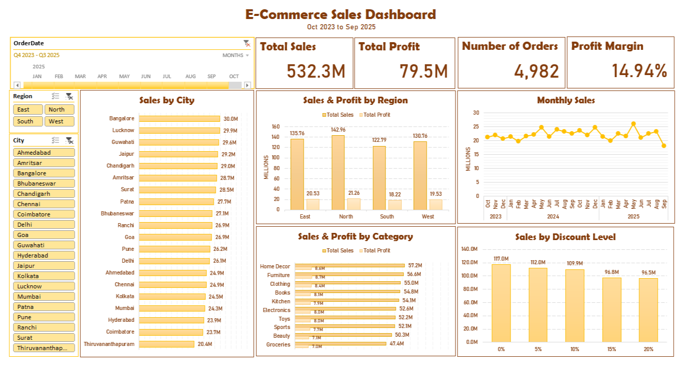

# E-Commerce Sales Dashboard – Microsoft Excel – Data Analytics

## Project Overview
An interactive Excel dashboard that analyzes e-commerce sales from October 2023 to September 2025. It is designed for a sales audience that wants a quick view of overall performance, top regions and cities, product categories, and the effect of discounts.

## Dashboard

## Dataset
- **Source:** [E-Commerce Sales by prince7489 (Kaggle)](https://www.kaggle.com/datasets/prince7489/e-commerce-sales)
- **License:** CC0: Public Domain
- **Date range:** 4 October 2023 to 3 October 2025 (the file name says 2024_2025)
- **Size:** 5,000 orders and 14 columns (order details, customer, region, city, category, quantity, unit price, discount, sales, profit, payment mode)
- **Note:** The dataset is synthetic (computer-generated), so some patterns may reflect how the data was created and not a real business.

## Tools
- **Microsoft Excel**
    - **Power Query:** used for data cleaning
    - **PivotTable:** used for summarization and exploration
    - **PivotChart:** used for the charts and dashboard
    - **Slicers and Timeline:** used for interactive filtering
 
## Files Included
- dashboard/ecommerce_dashboard.xlsx (The finished dashboard, with the cleaned data, PivotTables, and charts)
- data/Ecommerce_Sales_Data_2024_2025.csv (The original dataset from Kaggle)
- images/dashboard_preview.png (Screenshot of the dashboard)

## Data Cleaning Steps
- Set the correct data types (dates, whole numbers, decimals)
- Converted Discount from whole numbers to percentages
- Trimmed spaces and removed hidden characters in text columns, and standardized capitalization in the name, region, city, and category columns
- Checked for blanks, errors, duplicates, odd values, and typos
- Spot-checked that Sales matches Quantity × Unit Price × (1 − Discount)
- Kept all 5,000 rows

## Dashboard Components
- **KPI (Key Performance Indicator) Cards:**
    - Total Sales, Total Profit, Number of Orders, Profit Margin
- **Charts:**
    - **Line chart:** Monthly Sales
    - **Bar charts:** Sales by City, Sales & Profit by Category
    - **Column charts:** Sales by Discount Level, Sales & Profit by Region
- **Filters:**
    - Timeline, Region slicer, and City slicer
 
## Key Insights
The numbers cover October 2023 to September 2025. "M" means millions.
- **Overall:** 532.3M in sales, 79.5M in profit, 4,982 orders, and a 14.94% profit margin.
- **Trend:** monthly sales stay between about 20M and 25M with no clear growth. May is the peak (May 2025: about 26.0M), and September 2025 is the lowest month (about 18.1M).
- **Regions:** sales are spread evenly, from 23.1% (South) to 26.9% (North).
- **Categories:** Home Decor sells the most (57.2M) and Groceries the least (47.4M). Furniture earns the most profit (about 8.7M), and Beauty has the lowest margin (about 14%).
- **Cities:** Bangalore leads (about 30.0M), and Thiruvananthapuram is lowest (about 20.4M) with the fewest orders.
- **Discounts:** each level has roughly 1,000 orders, so bigger discounts did not bring in more orders. Sales fall from about 117.0M at 0% to about 96.5M at 20%, while the margin stays near 15%.

## Instructions for Use
1.	Download ecommerce_dashboard.xlsx from the dashboard folder.
2.	Open the file in Microsoft Excel (desktop version).
3.	Click Enable Editing if Excel asks.
4.	Explore the dashboard using the slicers and the Timeline. Click the small filter-clear icon on each one to reset it.

## Notes
- Analysis period: October 2023 to September 2025. The data ends on 3 October 2025, so that month is incomplete and is excluded using the Timeline. Clearing the Timeline brings back the full dataset (5,000 orders).
- The dashboard does not show a currency, and values are in millions (M).

## Author
**INGRID DOMINIQUE CORPUZ**

Aspiring Data Analyst | BSIT Graduate

LinkedIn: www.linkedin.com/in/ingrid-corpuz

